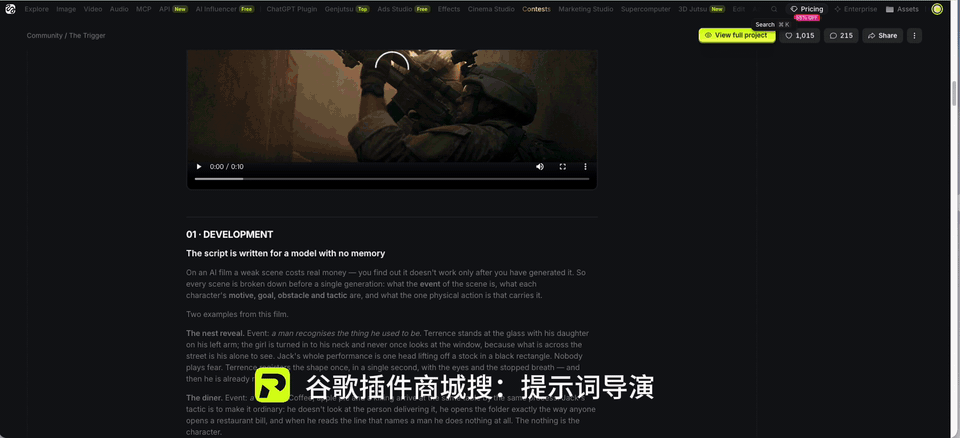
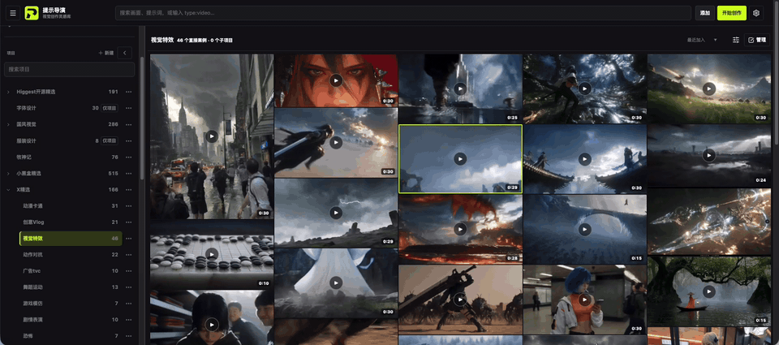
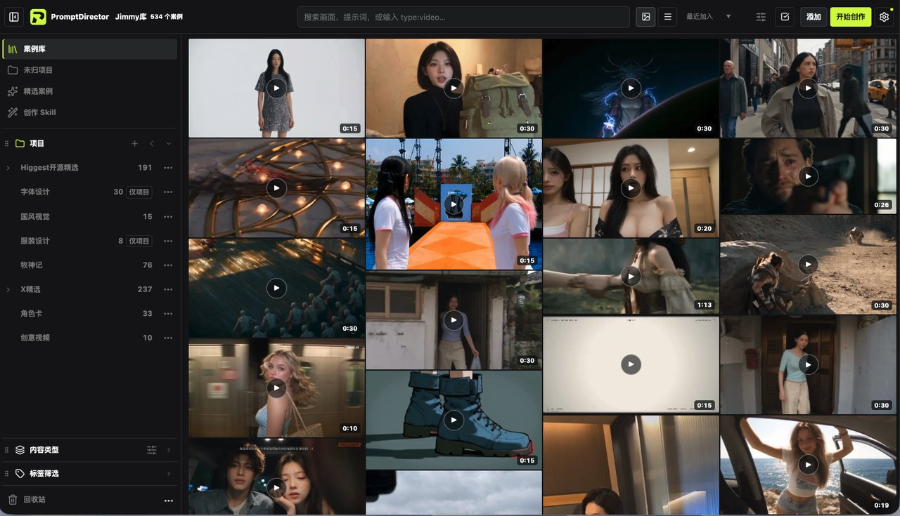
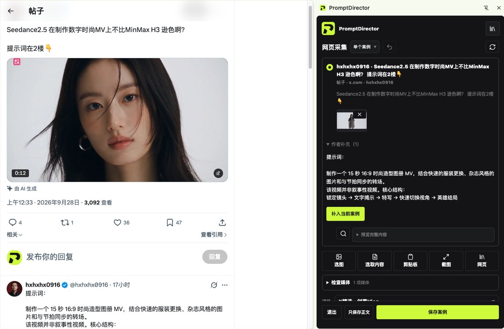
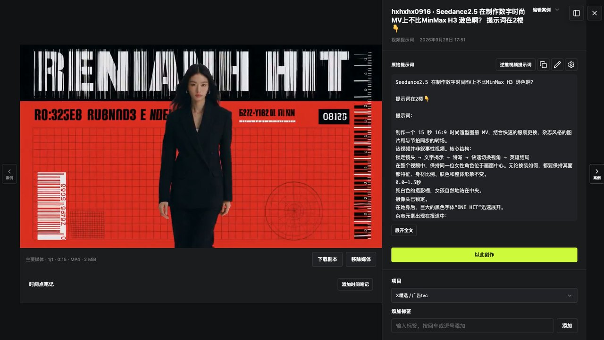
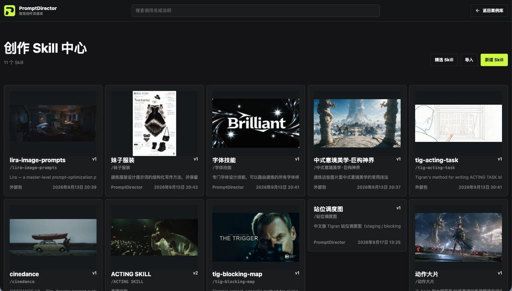

  

<h1 align="center">PromptDirector 提示词导演</h1>

<strong>Spot it. Save it.</strong> 刷到就存，要用就有

  
  
  
  

<strong>English</strong> · <a href="README.zh-CN.md">简体中文</a>

  

   
  <a href="https://www.youtube.com/watch?v=ttbNMJ7Gm7Q">▶ Watch the 71-second demo</a>

- **One click: image + prompt.** Save works, videos and their public prompts from Jimeng, Higgsfield, Midjourney, X, WeChat, Feishu and 20+ sites.
- **A library you browse by eye.** An image-first case wall with tags and projects. It's local-first and needs no account.
- **Your Agent can use it.** Codex, Claude Code and WorkBuddy can search, read and save back to your library through local MCP.
- **Ask the Assistant.** The built-in Assistant captures the page or video you are on, finds references in your library and opens cases for you — from the same sidebar.

<strong>1,000+ curated cases, ready to import:</strong> <a href="https://wchao6891.github.io/PromptDirector-Curated/en/">Browse (English)</a> · <a href="https://wchao6891.github.io/PromptDirector-Curated/?lang=zh-CN">浏览（中文）</a> · <a href="https://wchao6891.github.io/PromptDirector-Curated/en/guide.html">Quick start</a>

Free & open source · Local first · No account · Chrome / Edge on Windows, macOS, Linux

---

## See it in action

**1 · Spot it, save it.** Open a Higgsfield article and capture it. PromptDirector splits it into cases, keeps each image, video and prompt together and saves them to your library.

**2 · Turn references into a Skill.** Ask the Composer to find a creator's action cases in your library. It reads them and distills a reusable Skill.

**3 · Create with it.** Mix reference images and the Skill in the Composer to write a shot-by-shot video prompt, then generate with your favorite model.

<table>
<tr>
<td width="50%"></td>
<td width="50%"></td>
</tr>
<tr><td align="center"><b>Case wall.</b> Browse by eye, organize by project.</td><td align="center"><b>Capture from X.</b> Even the prompt in the author's reply.</td></tr>
<tr>
<td width="50%"></td>
<td width="50%"></td>
</tr>
<tr><td align="center"><b>Case detail.</b> Media, original prompt and source in one place.</td><td align="center"><b>Curated packs.</b> Import 1,000+ cases in one click.</td></tr>
<tr>
<td width="50%"></td>
<td width="50%"></td>
</tr>
<tr><td align="center"><b>Skill center.</b> Build, import and reuse creative Skills.</td><td align="center"><b>Composer.</b> References + Skill → a ready-to-use prompt.</td></tr>
</table>

## What's new

**An Assistant beside the page.** New in 1.27, the built-in Assistant sits in the capture sidebar. Ask it to capture the current page or video, find references in your library or open a case — originals, prompts and your own edits all stay where they are.

**Similar cases, and notes on the exact frame.** Cases list similar references from your library underneath, so one good find leads to more. On video, add a creative note at any timestamp and jump back to that moment later.

**A library that stays tidy.** Review duplicate cases that share the same image or video original, fill in missing text tags, complete the library index automatically, and restore anything you delete from the recycle bin.

**Backup, sync, and your Agent.** Back up and restore the whole library, sync it across devices, and copy the Agent connection request for Codex, Claude Code or WorkBuddy.

## Where you can capture

**Open a work, post or article → Capture → Preview and select → Save cases.**

| Where inspiration lives | What you can bring with you |
| --- | --- |
| **Jimeng · Higgsfield · LiblibAI · Krea · LibTV** | Work images, videos and publicly available prompts or creative details. Keep the visual and its context together. |
| **Midjourney** | Save the selected work, public prompt, parameters and video cover; capture loaded previews from Explore. |
| **HeyBox / 小黑盒 · WeChat articles** | Save a whole article or split clearly structured multi-case posts into selectable image-and-prompt groups. Keep a single HeyBox image gallery with its prompt from the post body. |
| **Feishu documents** | Capture document bodies, long documents and images within tables, preserving cell placement and merged cells. |
| **X / Twitter · Xiaohongshu · Weibo · Reddit** | Collect the current post's text and accessible media, including prompts shared by the author. |
| **Douyin · Bilibili · YouTube** | Video posts, captions and public prompts. Save online playback, or install the optional free local video component to keep the original file. |
| **Pinterest · Behance · ArtStation · Huaban · ZCOOL** | Bring visual work into one place to browse, search and organize. |
| **More webpages and local files** | General webpage capture, text and image selection, screenshots and local imports help gather scattered materials. |

**One article, many references.** For articles with clear case headings or numbering, preview the detected groups under **Cases in article**, pick the cases you want and save each one separately, or keep the whole article for context.

**Context stays with the reference.** Multi-image works stay grouped, articles keep their media order and Feishu tables keep their layout. Media, text, original prompts, sources and later analysis each have their own place.

**Videos capture like any other page.** Preview the video, keep its caption and public prompt, and save the case. With the optional free [local video component](docs/VIDEO_COMPONENT.md), the original file comes along too.

Capture, browsing and organization require no AI service. Pages must be accessible and original prompts must be public. Login state, lazy loading and site changes can affect results, so preview before saving. See the [capture guide](docs/CAPTURE_SUPPORT.md).

## Let your Agent take it further

Connect your library to **Codex, Claude Code or WorkBuddy**. Your Agent can search references, read prompts, retrieve originals, capture URLs and save creative materials back to the library.

The built-in Assistant covers the in-browser side; the Agent connection exposes the same library to Codex, Claude Code or WorkBuddy.

1. In the extension, open **Settings → Agent connection** and select **Copy connection request**.
2. Paste it into an Agent with local MCP support. It installs, configures and verifies the connector.
3. Enable the connection in Chrome when prompted.

> “Find character-poster references in my library and list a few options for me to choose.”
>
> “Read the selected cases' original images and prompts, then use them to draft this campaign's visual direction.”
>
> “Save the approved prompt and generated images back to PromptDirector.”

Other local MCP clients can use the generic configuration. Cloud-only workspaces can't use this local flow. [Agent setup guide →](connector/INSTALL.en.md)

## A library that grows with you

| What your next project needs | What your library provides |
| --- | --- |
| **A reference you can recognize at a glance** | An image-first case wall, text search and tag filters. |
| **A focused collection for each project** | Nested projects, related cases and batch management. |
| **Experience you can reuse** | The Composer reads selected cases and drafts editable prompts, reusable Skills and tag suggestions for your review. |
| **A second pair of eyes** | Similar cases under every case, timestamped creative notes, and an Assistant that captures, finds and opens cases beside the page. |
| **A library that stays tidy** | Recycle bin, duplicate review, automatic index completion, and batch tags or batch analysis. |
| **Room for more than images** | Local images, videos, audio, DOCX, PDFs, Markdown, TXT, HTML, RTF and timestamped video notes. |
| **A collection you can share and preserve** | Export cases or project subtrees, full folder backups, recovery on another computer and encrypted folder sync. |

AI analysis is optional and uses your own service. Only selected or explicitly requested original images are sent to a model.

## Your library stays yours

Cases, media, tags and settings are stored in your browser by default. No account, ads or usage analytics. AI features are opt-in and use your own keys. Read the [privacy policy](https://wchao6891.github.io/PromptDirector-Curated/en/privacy.html).

## Install

**Recommended: [Chrome Web Store](https://chromewebstore.google.com/detail/iahakaahijddcjjldidbclicedibgpjm).** Updates are automatic.

Install from GitHub (developer mode) and update in place

1. Download `PromptDirector-<version>.zip` from the [latest release](https://github.com/wchao6891/PromptDirector/releases/latest).
2. Extract it into a permanent folder named `PromptDirector` (no version number). `manifest.json` must be at the top level.
3. Open Chrome or Edge's extension page, enable **Developer mode**, select **Load unpacked** and choose that folder.

**Updating:** In Settings, check for updates and select the local upgrade action. On first use, authorize the folder Chrome currently loads and keep that location. The extension downloads, verifies and installs the update, then restarts. Your cases and media stay in the same browser library.

Optional local video capture uses a [free source component](docs/VIDEO_COMPONENT.md); no paid developer certificate is required. See [known limitations](docs/KNOWN_LIMITATIONS.md) for large-video and website coverage limits.

## Contribute and license

Contributions to capture adaptations, interactions, tests and documentation are welcome. When [reporting an issue](https://github.com/wchao6891/PromptDirector/issues), describe the page type, what you saw and the reproduction steps. Remove API keys, private data and unauthorized media. Run `npm run verify` before submitting code. See the [development guide](docs/DEVELOPMENT.md).

Code is licensed under [Apache License 2.0](LICENSE). See [THIRD_PARTY_NOTICES.md](THIRD_PARTY_NOTICES.md). The code license does not grant rights to third-party case media; check each curated case's source and rights before reusing its media.
